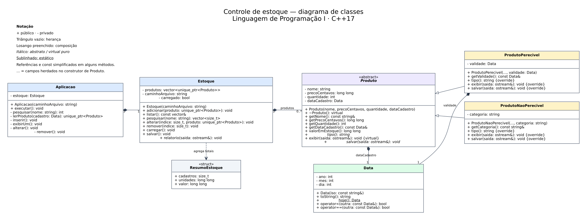
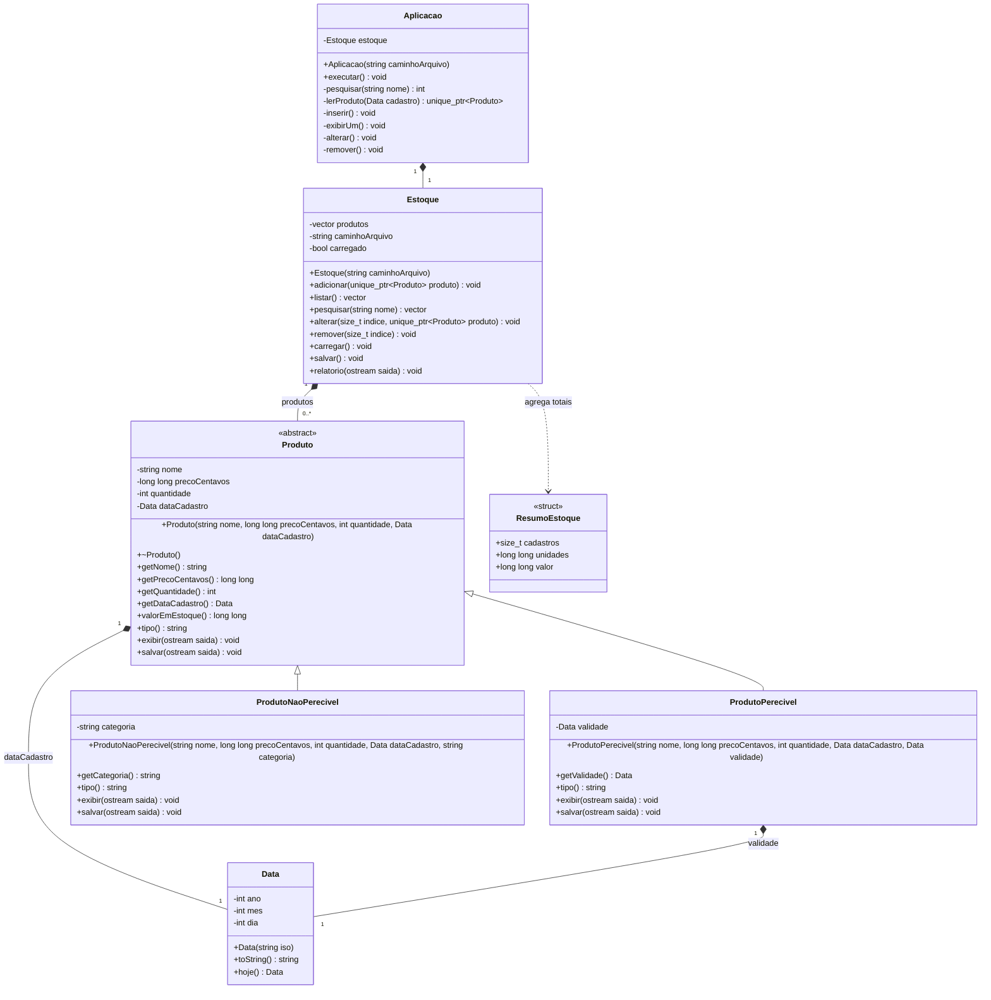

# Diagrama de classes

[Baixar PDF](diagrama-classes.pdf) · [Abrir SVG](diagrama-classes.svg) · [Fonte Graphviz/DOT](diagrama-classes.dot)



O diagrama representa a estrutura do sistema de controle de estoque. `Produto` é abstrata; as duas subclasses fornecem comportamentos específicos para exibição e gravação.



## Leitura das relações

- A seta de triângulo indica herança: produtos perecíveis e não perecíveis são produtos.
- O losango preenchido indica composição: cada produto possui sua data de cadastro; um perecível também possui uma data de validade.
- `Estoque` mantém a propriedade dos produtos por meio de um vetor de `std::unique_ptr<Produto>`.
- `Aplicacao` contém um estoque e coordena as opções do menu.
- `ResumoEstoque` é uma estrutura auxiliar com campos públicos, usada apenas para agregar totais no relatório; ela não representa um cadastro persistido.
- O sinal `-` indica atributo ou método privado; `+` indica acesso público.

Os métodos `tipo` e `salvar` de `Produto` são virtuais puros. `exibir` é virtual e as duas subclasses o sobrescrevem. Os métodos de consulta não alteram os objetos; o desenho omite detalhes de referências e `const` para facilitar a leitura. O vetor retornado por `Estoque::pesquisar` contém os índices dos candidatos; `Aplicacao::pesquisar` resolve a seleção e retorna um único índice, ou informa que não houve seleção.

Fonte editável: [diagrama-classes.mmd](diagrama-classes.mmd). O GitHub renderiza o bloco Mermaid desta página.


## Regenerar os arquivos visuais

O SVG e o PDF são arquivos independentes e podem ser usados na entrega ou abertos sem um renderizador Mermaid. Para regenerá-los, instale Graphviz e execute na raiz do projeto:

```sh
dot -Tsvg docs/diagrama-classes.dot -o docs/diagrama-classes.svg
dot -Tpdf docs/diagrama-classes.dot -o docs/diagrama-classes.pdf
```

O desenho Mermaid omite os operadores de comparação de `Data`, presentes no SVG/PDF. Os construtores abreviados do desenho SVG/PDF recebem também os quatro campos de `Produto`; as assinaturas completas constam nos arquivos `.hpp`.
